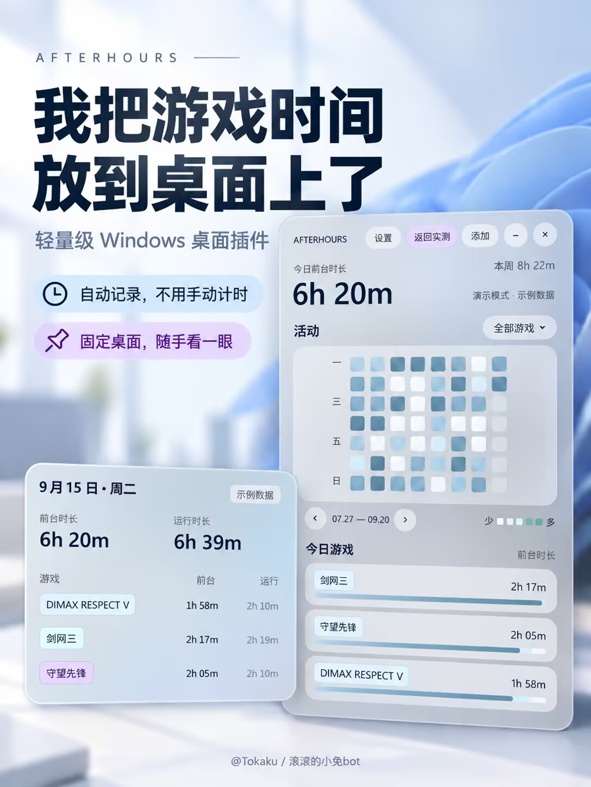
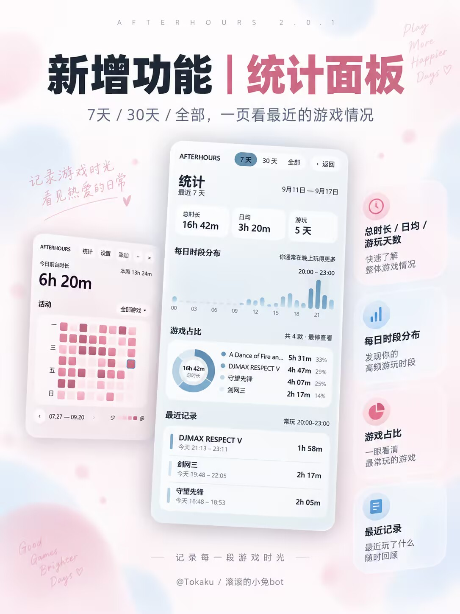
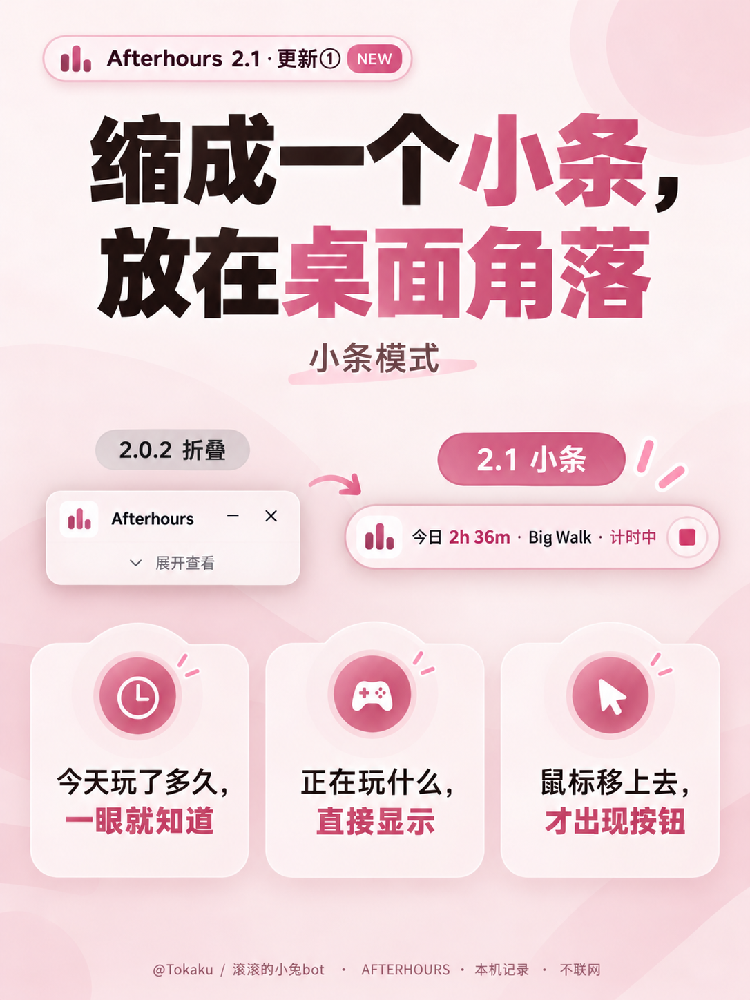
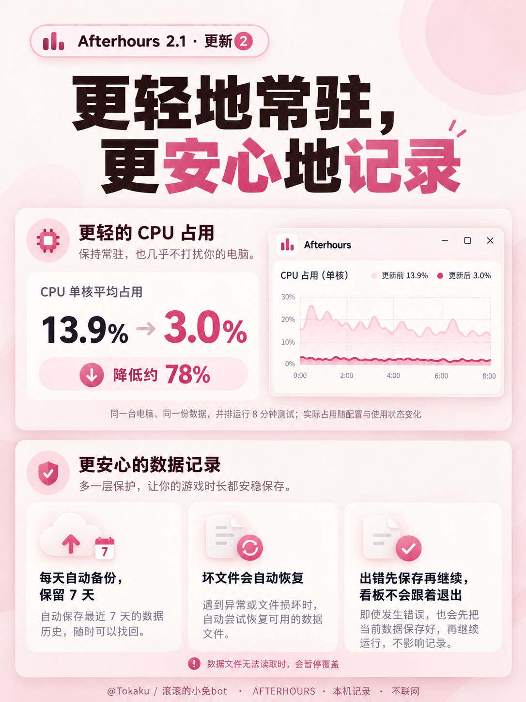

# Afterhours 2.1

**仓库：Tokaku7/Afterhours · [下载最新版 Afterhours-2.1.zip](https://github.com/Tokaku7/Afterhours/releases/latest)**

请在 Release 的 **Assets** 中下载 `Afterhours-2.1.zip`，完整解压后双击 **`Afterhours启动.vbs`**。下方的 `Source code` 为 GitHub 自动生成的源码压缩包。

## 界面与功能预览

<table>
  <tr>
    <td width="50%"><a href="docs/images/desktop-overview.png"></a></td>
    <td width="50%"><a href="docs/images/statistics-overview.png"></a></td>
  </tr>
  <tr>
    <td width="50%"><a href="docs/images/v2.1-mini-bar.png"></a></td>
    <td width="50%"><a href="docs/images/v2.1-performance-data.png"></a></td>
  </tr>
</table>

*图片为功能宣传示意，含旧版界面与示例数据；具体行为及限制以以下 2.1 说明为准。CPU 数字为作者本机测试结果；异常处理与备份不保证所有错误均可恢复。*

## 2.1 更新重点

**2026-10-24 修复：旧版数据迁移误报“历史日期格式不正确”的问题已修复。此前下载 2.1 且迁移失败的用户，请重新下载发布包，备份并退出程序后使用新版迁移；无需手动修改历史日期。**

- 优化 CPU 开销：作者本机 8 分钟对比测试，单核平均 13.9% → 3.0%，约降低 78%；实际表现因设备与场景而异，内存未见明显下降。
- 横向折叠小条显示今日时长和游戏状态，展开恢复之前的窗口大小。
- 新增每日备份、损坏文件恢复保护，以及设置中的旧版数据迁移入口。
- 累计数据约每 30 秒、会话约每 60 秒按变化保存，正常退出时尝试立即保存；强制结束或断电可能损失未保存记录。

完整变化见 [更新日志](更新日志.md)，老用户请先阅读 [数据迁移教程.txt](数据迁移教程.txt)。

> **老用户升级：先关闭旧版开机启动，再从托盘退出旧版并备份 data。新版完整解压到新文件夹，启动后点击“设置 → 迁移旧版数据…”，选择之前实际使用的旧版文件夹。到“统计 → 全部”核对历史后，更新桌面快捷方式，再按需开启新版自启。不要同时运行新旧版本，确认新版正常后仍请保留旧数据备份。**

> **启动方法：下载并完整解压后，双击 `Afterhours启动.vbs`。请不要直接在 ZIP 压缩包内运行。**

一款轻量的 Windows 桌面游戏时间看板。它在本机统计游戏的前台时长与运行时长，并用活动热力图和每日游戏卡片展示。

从旧版升级请先阅读 [`数据迁移教程.txt`](数据迁移教程.txt)；版本变化统一记录在 [`更新日志.md`](更新日志.md)。


## 功能

- **自动统计游戏时间**：每秒读取同一 Windows 会话中的进程，分别累计游戏处于前台和后台运行的时间。
- **系统托盘**：启动脚本保持隐藏，托盘菜单提供“退出 Afterhours”，不占任务栏。
- **专属托盘图标**：月牙与四格活动图形用于标识 Afterhours，在浅色和深色任务栏上均保持清晰。
- **Steam 自动识别**：启动时读取本机 Steam 安装清单，按游戏目录识别游戏进程；Steam 客户端、启动器、崩溃报告和常见反作弊辅助程序不会计入。
- **常见游戏预设**：内置剑网三、守望先锋和三角洲行动的常见进程规则。
- **特殊游戏回退识别**：内置 Apex Legends 和无限暖暖的实际游戏进程规则，在反作弊导致路径不可读时仍可识别。
- **手动添加游戏**：运行游戏后从进程列表选择一次并命名，以后自动统计，适用于其他平台和特殊启动方式。
- **活动热力图**：以 8 周为一页显示每日前台时长，可前后翻页。
- **按游戏筛选**：点击今日游戏卡片或游戏菜单，可查看单款游戏的专属热力图；清除筛选后恢复全部游戏汇总。
- **悬停查看当日明细**：热力格显示日期、前台时长、运行时长及各游戏明细。
- **今日游戏可视化**：游戏卡片显示前台时长和比例条，悬停可查看运行与后台时长。
- **可视化统计页面**：支持 7 天、30 天和全部记录筛选，用 24 小时时段分布、游戏占比环图、常玩时段与精确会话记录展示游戏时间。
- **桌面层显示**：看板位于普通应用和游戏窗口下方，不置顶、不抢焦点；按 `Win + D` 可查看。
- **透明玻璃界面**：主窗口、菜单和明细卡都只在圆角内部绘制半透明渐变，圆角外保持完全透明。
- **可调整窗口**：可拖动右下角或窗口边缘改变大小，最窄可缩至 300 像素；字体、按钮、热力格、卡片和统计图会随窗口等比缩放，热力图卡片减少两侧留白，纵向空间不足时可滚动；窗口会尝试调整回屏幕可用区域。
- **横向小条**：点击“−”折叠成约 320×64 的小条，显示今日时长、状态圆点和当前游戏（如“剑网三 · 本次 45m”）；鼠标移上去出现展开和退出按钮，展开后恢复之前的尺寸。
- **主题与深色模式**：提供极地雾、极光薄荷、烟粉、暮光紫四种主题，主题同步作用于热力图、标签、进度条和统计图表。
- **可选开机启动**：默认关闭，可在设置中为当前 Windows 用户开启或关闭。
- **手动游戏管理**：可以删除错误或多余的手动进程规则，不影响内置和 Steam 自动规则。
- **独立演示模式**：内置 56 天合成示例历史，不写入真实统计数据；切回实测即可恢复真实看板。
- **本地持久化**：数据有变化时自动原子保存（先写入磁盘再替换），保留 `.bak` 和最近 7 天的每日备份；退出时尝试立即保存，并增加锁屏、睡眠、关机事件的保存处理；异常结束仍可能丢失未保存记录。
- **损坏保护**：数据文件损坏时自动从备份恢复；无法恢复时暂停写入该文件，不会用空数据覆盖原记录。
- **锁屏和休眠保护**：锁屏、休眠、桌面不可读或采样间断超过 5 秒时不累计该间隔。

## 运行

1. 下载并完整解压发布包，不要直接在 ZIP 中运行。
2. 双击 `Afterhours启动.vbs`。这是正常启动入口，不会显示命令行窗口。
3. 按 `Win + D` 回到桌面，在右上角查看看板。

环境要求：64 位 Windows、系统自带的 Windows PowerShell 5.1 和 WPF。不需要安装 Python、Node，也不需要登录 Steam 账号。

如果启动失败，双击 `诊断启动.cmd` 查看错误；也可以在解压目录打开终端运行：

```powershell
powershell.exe -NoProfile -ExecutionPolicy Bypass -STA -File .\程序文件\Launcher.ps1
```

启动失败的错误会写入 `data/startup-error.log`，运行中出现的错误会写入 `data/runtime-error.log`。

## 数据与隐私

Afterhours 完全在本机运行，不联网，不读取键盘鼠标输入、游戏内容或窗口标题。程序只读取：

- 当前前台进程及同一用户会话中的运行进程；
- Steam 注册表安装位置和本地游戏清单，用于识别游戏；
- 用户手动添加的游戏进程名。

首次运行后会在程序目录生成 `data` 文件夹：

- `activity.json`：按日期和游戏保存累计秒数；
- `games.json`：手动添加的游戏规则；
- `preferences.json`：主题和深色模式设置；
- `runtime.json`：当前进程和窗口运行状态；
- `sessions.json`：2.0 开始记录的前台游戏会话及起止时间；
- `backups/`：每日自动备份，保留最近 7 天；
- `*.corrupt-时间`：检测到损坏时保留的原文件，便于排查；
- `startup-error.log`：仅在启动失败时生成；
- `runtime-error.log`：运行中出现错误时追加记录。

发布包不包含开发者的 `data`、个人游戏记录、本机安装路径或日志。转发自己运行过的副本前，请删除自己的 `data` 文件夹。

启用开机启动时，程序会在当前用户的 `HKCU\Software\Microsoft\Windows\CurrentVersion\Run` 中写入启动命令，其中包含用户选择的软件目录路径；关闭开机启动会移除该项。

## 统计口径与限制

- 只统计看板运行期间的活动，不能回填过去的游戏时间。
- 精确会话时间轴从 2.0 开始记录；1.0 的按日汇总无法反推出过去的具体起止时间。
- 前台时长代表游戏进程连续处于前台的采样时间，可能包含挂机。
- 同一游戏短暂切出 2 分钟内回来，会话记录合并为同一次游戏。
- 新安装 Steam 游戏后需重启看板以刷新清单。
- 特殊启动器、受保护程序或特殊目录结构可能需要手动添加。
- 采样统计存在约一个采样周期的保守误差。
- 当前版本是 PowerShell/WPF 预览版，尚未签名，也未完成多机兼容性测试。

## 从旧版升级

设置中提供“迁移旧版数据…”入口：迁移前展示记录概况并自动备份，有冲突时提示确认。完整步骤见 `数据迁移教程.txt`。1.0 没有精确会话起止时间，无法恢复这部分历史。

## 项目文件

外层是启动入口和说明，程序本体在 `程序文件/` 中：

- `Afterhours启动.vbs`：正常启动入口，无控制台窗口。
- `诊断启动.cmd`：前台启动并显示错误，用于排查。
- `程序文件/Launcher.ps1`：启动器，负责数据目录和错误日志。
- `程序文件/Live.ps1`：主界面、交互、筛选、主题和数据调度。
- `程序文件/Tracker.ps1`：进程采样、Steam 扫描、计时和保存。
- `程序文件/Silver.xaml`：WPF 界面。
- `程序文件/DayCard.ps1`：热力图悬停明细卡。
- `程序文件/Demo.ps1`：独立示例历史。
- `程序文件/DesktopLayer.cs`：桌面层级、无焦点窗口、毛玻璃和原生圆角。
- `程序文件/Migration.ps1`：旧版数据迁移。
- `程序文件/Afterhours.ico`：包含 16 至 256 像素的 Windows 多尺寸托盘图标。

## 卸载

先在设置中关闭开机启动，退出看板，然后删除整个文件夹。
